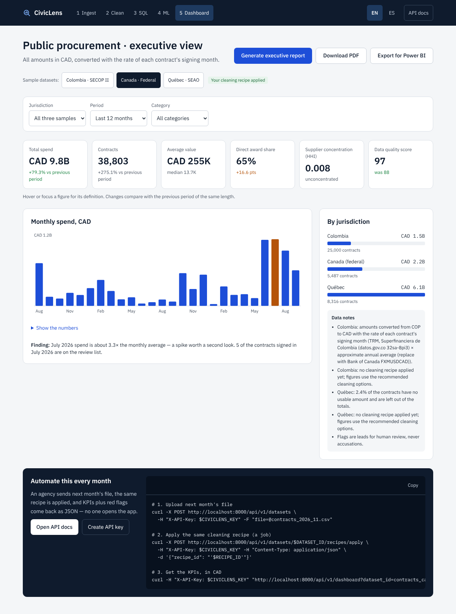
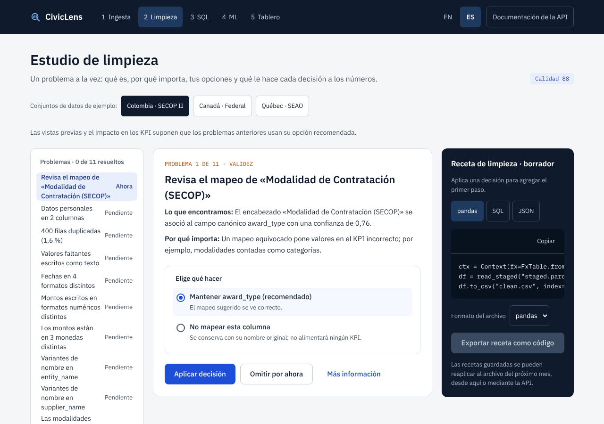
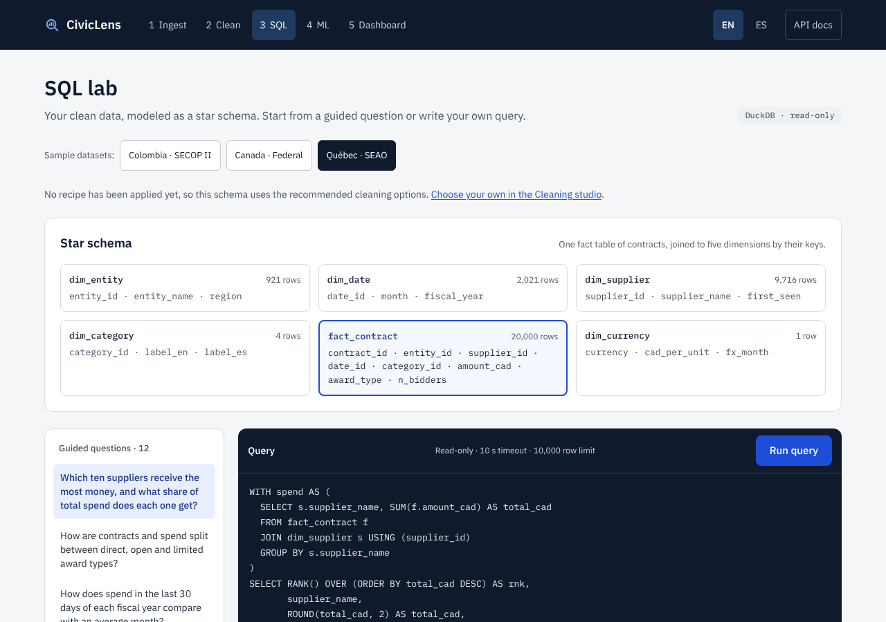
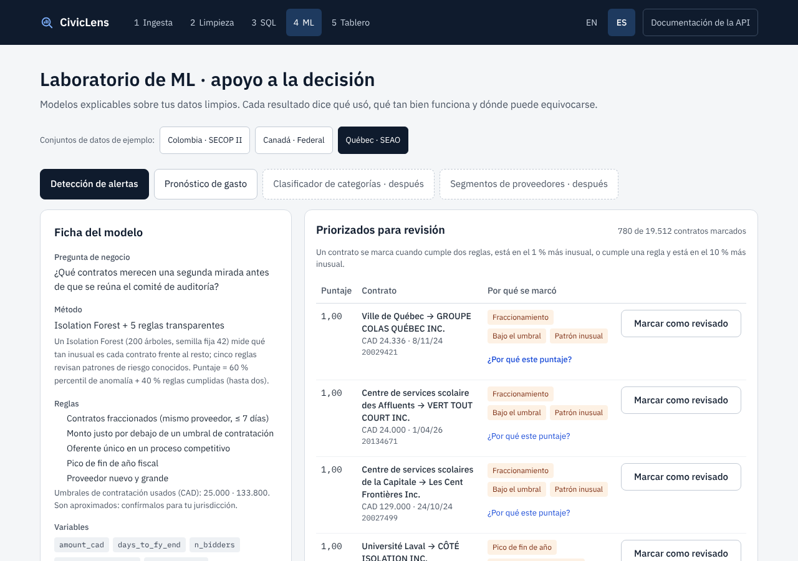
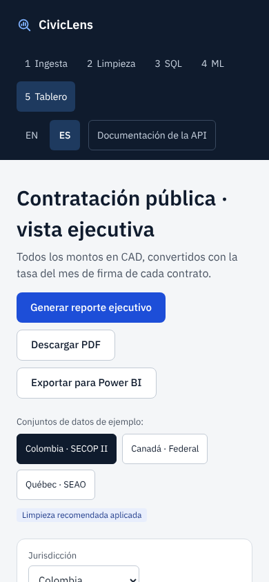
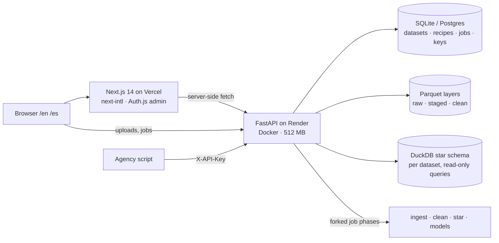

# CivicLens

**Public-sector data analytics engine — from messy public files to decisions you can defend.**

A web app and a public REST API that run the whole analytics lifecycle on government contract
data: ingest → profile → guided cleaning → SQL modeling → explainable machine learning →
executive dashboard and report. The interface is in **English and Spanish**; the data can be in
**English, French or Spanish**.

- **Live app:** https://civiclens-eosin.vercel.app (`/en`, `/es`)
- **API docs:** https://civiclens-api.onrender.com/docs (free instance: the first request may take ~50 s while it wakes up)
- **Resumen en español:** [abajo](#resumen-en-español)



## Case study

### The problem

Public procurement data is published, but not usable as is. Three real, open sources show why:

| Source | Language | Format | What is wrong with it |
|---|---|---|---|
| Colombia · SECOP II | Spanish | CSV, `;`, Windows-1252 | amounts in COP with `1.234,56` notation, 400 duplicate rows (1.6 %), personal ID numbers in two columns, four date formats |
| Canada · federal proactive disclosure | English / French | XLSX with a title row | bilingual headers, amounts in CAD and USD, `n/a` written as text |
| Québec · SEAO | French | nested JSON | coded nulls, French notation, mixed date formats |

An analyst answering "how much did we spend, with whom, and what deserves a second look?" spends
most of the time cleaning — usually by hand, every month, without a record of what was changed.

### The approach

1. **Ingest & profile.** CivicLens detects the format, encoding, delimiter, header row and data
   language. It maps headers to one canonical schema and scores quality row by row.
2. **Guided cleaning.** It finds 10–11 issue types per file and offers options for each. Before you
   choose, it shows the before/after rows and the effect on the KPIs. Your decisions become a
   **versioned recipe** (JSON) that exports to a pandas script and to DuckDB SQL, and replays
   deterministically: the same input gives the same output hash.
3. **SQL modeling.** It builds a star schema (`fact_contract` + 5 dimensions, amounts in CAD
   converted at each contract's signing month, each jurisdiction's fiscal calendar). A read-only,
   guarded SQL lab comes with 12 guided business questions and a 9-KPI catalog with definitions.
4. **Decision support.** Two models:
   - **Red flags for human review**: Isolation Forest plus five transparent rules (split contracts,
     just under a threshold, single bidder, year-end spike, new and large supplier), with exact
     per-contract feature contributions.
   - **Spend forecast**: compared honestly against a seasonal-naive baseline (MAPE on a held-out
     year).
5. **Report & API.** An executive dashboard compares the three jurisdictions in one currency, and a
   one-click report comes out as HTML and PDF in the reader's language. An export feeds Power BI or
   Tableau. The same pipeline is available through a REST API with scoped, revocable keys, so an
   agency can send next month's file and get KPIs and red flags back as JSON.

### The results

- **3 jurisdictions, 55,000 contracts, one currency.** The dashboard compares about CAD 29 B of
  spending across Colombia, Canada and Québec, with every conversion dated and cited (official TRM
  for COP, Federal Reserve monthly average for USD).
- **Cleaning becomes repeatable.** A recipe saved once replays on the next file with the same output
  hash. It exports to code an analyst can audit without CivicLens.
- **Numbers that agree everywhere.** The report, the KPI endpoint, the dashboard and the red-flag
  model use one cleaned row count; tests cross-check them.
- **Leads, not accusations.** Between 2 % and 4 % of contracts are flagged, depending on the jurisdiction. Each flag lists its reasons, and the
  model card says what the model cannot know.
- **Runs on $0 infrastructure.** The API fits the 512 MB free Render instance: the full flow on the
  three datasets peaks at ~405 MB, and CI enforces the limit on every PR.

| Cleaning studio (ES) | SQL lab (EN) | ML lab (ES) |
|---|---|---|
|  |  |  |



### Quality gates

Every PR must pass all of these before it can deploy:
- API lint and tests (378 tests, 94 % coverage, SQLite and Postgres 16)
- Schemathesis contract tests against `openapi.yaml`
- the API Docker image running **in 512 MB** with the full flow, the Playwright journeys in `/en`
  and `/es`, and a **k6** load test (20 users, p95 < 1.5 s)
- axe accessibility checks (WCAG 2.1 AA, both languages, 375 px and 1280 px)
- an E2E check that no text is clipped in either language
- EN/ES catalog parity
- gitleaks and pip-audit

Render and Vercel deploy `main` only after these checks pass. A post-deploy smoke test opens an
issue with rollback steps when production breaks ([runbook](docs/runbook.md)).

<br clear="right">

## Architecture



ADRs and the full architecture are in [`docs/architecture.md`](docs/architecture.md) and [`docs/adr/`](docs/adr/).

| Layer | Choice |
|---|---|
| Web | Next.js 14 · TypeScript · Tailwind · next-intl (EN/ES) · Auth.js · Vercel |
| API | FastAPI · Python 3.11 · Docker · Render (free, 512 MB) |
| Analytics | DuckDB + Parquet · pandas |
| ML | scikit-learn (Isolation Forest, gradient boosting) · exact Shapley values |
| Reports | Jinja2 (HTML) · fpdf2 (PDF) |
| Quality | pytest · Schemathesis · Vitest · Playwright · axe-core · k6 · gitleaks · pip-audit |

## API quickstart

```bash
API=https://civiclens-api.onrender.com
# KPIs of a sample dataset, in Spanish (machine fields stay English)
curl -H "Accept-Language: es" "$API/api/v1/kpis/secop_co"
# The three jurisdictions compared in CAD, last 12 months, services only
curl "$API/api/v1/dashboard?dataset_id=secop_co&dataset_id=contracts_ca&dataset_id=contracts_qc&period=12m&category=services"
# Executive report as PDF, in English
curl -o report.pdf "$API/api/v1/reports/contracts_qc?format=pdf&lang=en"
# Agency flow: upload next month's file with a key, apply the saved recipe, read the job
curl -X POST "$API/api/v1/datasets" -H "X-API-Key: $CIVICLENS_KEY" -F "file=@contracts_2026_11.csv"
curl -X POST "$API/api/v1/datasets/$DATASET_ID/recipes/apply" -H "X-API-Key: $CIVICLENS_KEY" \
  -H "Content-Type: application/json" -d "{\"recipe_id\": \"$RECIPE_ID\"}"
curl "$API/api/v1/jobs/$JOB_ID"
```

Errors are RFC 7807 problems with a stable `code`, and their text follows `Accept-Language`. Keys
are issued in the admin console (`/admin`, GitHub sign-in of the owner only). The star schema
export for BI tools is described in [`docs/bi-export.md`](docs/bi-export.md).

## Run locally

```bash
cp .env.example .env
docker compose up --build
# web → http://localhost:3000 (redirects to /en or /es) · api → http://localhost:8000/docs
```

Without Docker:

```bash
cd apps/api && pip install -e ".[dev]" && alembic upgrade head && uvicorn app.main:app --reload
cd apps/web && npm ci && npm run dev
```

Checks: see [`CLAUDE.md`](CLAUDE.md) → Commands. Load test: [`load/k6-kpis.js`](load/k6-kpis.js).

## Skills this project demonstrates

| Skill | Where |
|---|---|
| Data cleaning, data quality scoring | `apps/api/app/core/cleaning/`, Cleaning Studio |
| SQL, dimensional modeling, KPI definitions | `apps/api/app/core/sql/`, SQL lab, `docs/bi-export.md` |
| Machine learning with explanations and honest baselines | `apps/api/app/core/ml/`, ML lab model cards |
| Executive reporting, BI | dashboard, HTML/PDF report, Power BI / Tableau export |
| API design, security | `openapi.yaml`, scoped argon2 keys, rate limits, RFC 7807, CSP |
| Testing and CI/CD | `.github/workflows/ci.yml`, gated deploys, `docs/runbook.md` |
| Accessibility and bilingual UX | axe in CI, EN/ES catalogs, `docs/glossary.md` |

## Resumen en español

**CivicLens** es un motor de analítica para datos de contratación pública. Carga archivos en
inglés, francés o español, enseña a limpiarlos paso a paso, los modela en SQL, aplica modelos
explicables y genera el tablero y el reporte ejecutivo, todo en inglés y en español.

**Caso:** tres fuentes reales y abiertas, con problemas distintos:
- **SECOP II (Colombia):** CSV en pesos con notación `1.234,56`, duplicados y cédulas.
- **Divulgación federal de Canadá:** XLSX con encabezados bilingües y dos monedas.
- **SEAO (Quebec):** JSON anidado en francés.

CivicLens convierte las decisiones de limpieza en una **receta versionada** que se reaplica cada mes
y se exporta a pandas y SQL. Construye un **esquema estrella** en CAD con tasas mensuales fechadas y
citadas, y compara las tres jurisdicciones (55.000 contratos) en un solo tablero. Las **alertas** son
pistas para revisión humana, con sus razones; nunca acusaciones. El mismo flujo funciona por **API**
con claves revocables, para que una entidad envíe el archivo del mes y reciba los KPI en JSON.

**Resultados:**
- Cifras consistentes entre el reporte, los KPI y las alertas, verificadas por pruebas.
- El reporte en HTML y PDF sale en el idioma de quien lo lee.
- Accesibilidad WCAG AA en ambos idiomas.
- Toda la API funciona en 512 MB de infraestructura gratuita, con pruebas que lo exigen en cada cambio.

## Author

María Alejandra Boada Rodríguez — Data Analyst · Software Engineer

## License

MIT. Dataset licenses and attribution are in [`data/seed/README.md`](data/seed/README.md) and in the app (report notes, landing footer).
