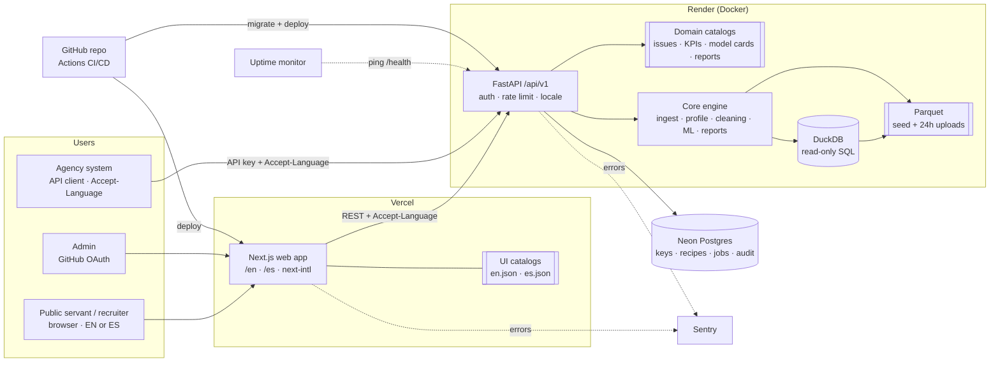

# CivicLens — Build Roadmap (zero → production) · v2

> **Role for the AI:** senior full-stack developer who has taken products from zero to production. Make pragmatic decisions that balance quality, delivery speed and cost. Justify every technical decision, state assumptions, and name the trade-off accepted.
> **Companion doc:** `CIVICLENS_SPEC.md` (functional detail). This file = **how and in what order** we build it, and it **overrides the spec** where they differ.
> **Approved mockups (source of truth for UI):** https://claude.ai/artifact/1FACLDLoSx3hTmETMXnVr9 — 6 screens, described in §3 Phase 2.

### Changes in v2
1. **Bilingual UI: English + Spanish** (overrides spec §0 "English only"). Repo, code, commits and technical docs stay in English.
2. Phase 2 (wireframes) is **done**: mockups approved and documented below.
3. i18n added to design system, architecture, API, testing, DoD and production checklist. Timeline 24 → 25 days.

---

## 0. Inputs

- **Concept:** Web app + public API that runs the full analytics lifecycle (ingest → profile → guided cleaning → SQL modeling → ML → dashboard/report) on public-sector data. For (a) public servants who must understand their data and decide, (b) government agencies that need repeatable reporting via API, (c) recruiters evaluating the owner as a Data Analyst. Problem solved: public data arrives fragmented, multilingual and dirty, and reporting is manual.
- **Two separate language concepts — never mix them:**
  - **UI language** (what the user reads): **EN or ES**, user-selectable.
  - **Data language** (what the file contains): **EN, FR or ES**, auto-detected. Canonical schema field names are always English (`signed_date`, `amount_cad`) regardless of UI language; their *labels* are translated.
- **MVP features (must-have):**
  1. Multi-format, multilingual ingest + data-quality profile (CSV/XLSX/JSON; data in EN/FR/ES).
  2. Educational Cleaning Studio with replayable **cleaning recipes** (exportable as pandas + SQL).
  3. SQL Lab over an auto-built star schema with guided queries + KPI catalog.
  4. ML decision support: anomaly/red-flag detection + spend forecasting (classification & clustering = stretch).
  5. Executive dashboard + one-click report + public REST API with API keys.
  6. **Full UI, educational content and executive report available in English and Spanish.**
- **Stack:** Next.js 14 + TypeScript + Tailwind + **next-intl** (Vercel) · FastAPI + Python 3.11 (Docker on Render) · DuckDB + Parquet (analytics) · PostgreSQL on Neon (app data) · scikit-learn/statsmodels · GitHub + GitHub Actions. Justified in Phase 4.
- **Team:** 1 full-stack developer (Alejandra) as product owner/reviewer + Claude (claude.ai, Pro plan) as implementing agent.
- **Timeline:** **25 working days** (~3–4 h/day). One phase or slice per chat to fit Pro usage windows.
- **Constraints:** secure auth for admin + API, PII protection, WCAG 2.1 AA, mobile-usable (dashboard readable at 375 px), bilingual EN/ES, $0 infrastructure for MVP.
- **Key risks:** Scope (over-design of cleaning/ML; translating everything twice) · Technical (multilingual parsing, locale formatting, DuckDB performance, SQL injection via SQL Lab, file uploads) · Delivery (Python backend deploy, cold starts, free-tier limits, Pro usage limits).

## 1. Assumptions (explicit)

- A1. Seed data = 3 public procurement datasets (Colombia SECOP II – ES – CSV; Canada federal contracts – EN/FR – XLSX; Québec contracts – FR – JSON). Alejandra downloads them (Claude's workspace cannot reach government portals) and attaches them.
- A2. Public demo needs **no end-user accounts**. Only the owner/admin signs in (to issue API keys). Agencies authenticate with API keys.
- A3. Uploads are temporary (≤24 h) and ≤50 MB; seed data is permanent.
- A4. Single backend instance is enough for MVP traffic (portfolio + pilot agencies).
- A5. FX rates for currency unification come from a static, dated table (source cited) — not a live API.
- A6. Claude can push to the GitHub repo once connected; Vercel is already connected to Claude; Render is connected by Alejandra once.
- A7. **Translations are written by Claude and reviewed by Alejandra (native Spanish).** Spanish = neutral Latin American Spanish. No machine-translation API at runtime.
- A8. Default UI language = browser `Accept-Language` (es* → ES, otherwise EN); user choice persists in a cookie and in the URL (`/en/...`, `/es/...`).
- A9. Data values are **never translated** (supplier names, descriptions stay as in the source). Only UI text, labels, issue explanations, model cards and reports are translated.

## 2. Trade-offs accepted

| Decision | Gain | Cost accepted |
|---|---|---|
| Render free tier for API | $0 | Cold start ~30–60 s after idle → "Waking up the engine…" state + uptime ping |
| DuckDB in-process instead of a warehouse | Fast SQL on Parquet, zero infra | Single-node; not for multi-GB data |
| No Redis/queue; jobs in Postgres + FastAPI background tasks | Fewer services | Jobs lost on restart mid-run (re-runnable by design) |
| In-memory rate limiting (slowapi) | Simple | Resets on restart; fine for 1 instance |
| Uploads on ephemeral disk, no S3 | No storage service | Files can vanish on redeploy (24 h TTL anyway) |
| Classical ML only (sklearn) | Explainable, cheap, fast | Less "wow" than deep learning — explainability matters more for government |
| Vertical slices per module | Working software early | Phases 5–7 overlap; DoD still checked per phase |
| No LLM in the core flow | $0, deterministic | Header/value mapping via dictionaries + fuzzy match |
| **Static translation catalogs (JSON), 2 UI languages only** | Fast, testable, no runtime cost | French UI not offered (French *data* is supported); every new string must be added twice |
| **Translatable educational content stored as keyed catalogs, not free text in code** | One source per language, testable for missing keys | Slightly slower to author issue cards and model cards |
| **API messages localized via `Accept-Language`, field names always English** | Agencies get stable contracts in either language | Two message sets to maintain |

---

## 3. Roadmap by phase

### Phase 0 — Repository & GitHub setup (Day 1)
- **Activity:** Create public GitHub repo `civiclens`; monorepo scaffold (`apps/web`, `apps/api`); MIT license; `.gitignore`; `.env.example`; README skeleton (EN, with a short ES summary section); PR + issue templates; Conventional Commits; branch protection on `main` (PR required, CI must pass); GitHub Project board with one issue per phase; connect repo to Claude with push access.
- **Tools:** GitHub, GitHub Projects, gitleaks, pre-commit (ruff, black, eslint, prettier).
- **Risk:** Delivery (lost work, leaked secrets).
- **Justification:** Everything after this is a PR → traceable history recruiters can read. Trade-off: PR ceremony slows a 1-person team slightly; worth it for review and CI gates.
- **Deliverable:** Repo URL, board with ~11 issues, first green CI run.
- **DoD:** `git clone` + `docker compose up` shows "hello" from web and `/health` from API; gitleaks passes; `main` protected.

### Phase 1 — Requirements (Day 2)
- **Activity:** Turn the spec into user stories with acceptance criteria (Given/When/Then) for 3 personas: *Public servant* (ES or EN speaker), *Agency integrator*, *Recruiter*. MoSCoW prioritization; freeze MVP scope. Write the **glossary EN↔ES** for domain terms (e.g. direct award ↔ contratación directa, red flag ↔ alerta, supplier ↔ proveedor, recipe ↔ receta). Download + document the 3 datasets (source, license, date, rows).
- **Tools:** GitHub Issues, Markdown.
- **Risk:** **Scope** (over-design) + consistency of terminology.
- **Justification:** A frozen "Must" list is the main defense against building 4 ML models before the dashboard works; a glossary avoids inconsistent Spanish across screens. Trade-off: classification + clustering moved to "Should".
- **Deliverable:** `docs/requirements.md`, `docs/glossary.md` (EN/ES), `data/seed/README.md` dataset cards.
- **DoD:** ≥15 stories with testable criteria (incl. ≥2 language stories); every "Must" maps to a phase; glossary ≥40 terms; 3 dataset licenses confirmed open.

### Phase 2 — Wireframes / mockups ✅ DONE (approved)
- **Activity (completed):** 6 desktop screens in a clickable design canvas: https://claude.ai/artifact/1FACLDLoSx3hTmETMXnVr9
- **Screen inventory (build these exactly; adapt only for i18n and responsiveness):**

| # | Screen | Route | Key elements to implement |
|---|---|---|---|
| 0 | Landing | `/[locale]` | Header with lifecycle nav (1 Ingest · 2 Clean · 3 SQL · 4 ML · 5 Dashboard) + API docs; hero with 2 CTAs ("Try with sample data", "Upload my own file"); "What one run produces" card; 5 lifecycle cards; 3 sample-dataset cards (language + format badges); footer (author, GitHub, portfolio, dataset licenses) |
| 1 | Ingest & profile | `/[locale]/datasets/[id]` | Dropzone (CSV/XLSX/JSON, 50 MB, 24 h note); detected metadata grid (format, encoding, delimiter, data language %, rows×cols, storage); Data Quality Score with 4 bars (completeness, uniqueness, validity, consistency); PII alert card with "Mask both"/"Review"; header-mapping table (source header, detected type, canonical field, confidence, nulls; low confidence → editable select flagged "check"); footer bar "N issues found → Continue to cleaning" |
| 2 | Cleaning studio | `/[locale]/datasets/[id]/clean` | Left: issue list with status (Done / Now / To do) and "x of 7 resolved"; center: Issue card (category tag, title, "What we found", "Why it matters", radio options with hint, Before/After panel, KPI impact strip with FX note, Apply / Skip / Learn more); right (dark): Recipe panel with steps, tabs pandas/SQL/JSON, code preview, "Export recipe as code". **Interaction:** changing an option updates After, KPI impact and recipe live |
| 3 | SQL lab | `/[locale]/datasets/[id]/sql` | Star schema block (fact_contract center + 5 dims); guided questions list (12); dark editor with guardrails line (read-only · 10 s · 10,000 rows) and Run; results table with row count + ms; "What this query teaches" explanation |
| 4 | ML lab | `/[locale]/datasets/[id]/ml` | Model tabs (Red flags, Forecast, Classifier · later, Segments · later); Model card (business question, method, rules, features, warning "leads, not accusations", Re-run); Ranked-for-review table (score, contract, reason chips, Mark reviewed); feature-contribution bars (SHAP) with legend |
| 5 | Dashboard & API | `/[locale]/datasets/[id]/dashboard` | Title + currency note; Generate executive report / Export for Power BI; filters (jurisdiction, period, category); 6 KPI tiles (total spend, contracts, avg value, direct award, HHI, data quality before→after); monthly spend bar chart with highlighted peak + written finding; by-jurisdiction bars + data notes; dark API block with curl example and Open API docs / Create API key |

- **Visual language (from mockups):** IBM Plex Sans + IBM Plex Mono; ground `#F4F6F8`, surface `#FFFFFF`, ink `#0F1B2D`, text `#1F2A37`, muted `#4B5563`, border `#D7DDE4`, primary `#1D4ED8` (tint `#E8EEFC`), warning/flag `#B45309` (tint `#FDF1E4`, text `#7C2D12`), success `#15803D`. Radius 8 px controls / 12 px cards. Blue vs orange (never red vs green) for good vs attention.
- **i18n additions not drawn in the mockups:** language switcher `EN | ES` in the header (right side, before API docs), visible on every screen; layouts must tolerate Spanish strings ~25–30 % longer (buttons wrap, no fixed-width labels).
- **Deliverable:** canvas (done) + `docs/ux-flow.md` with the table above and screenshots.
- **DoD:** ✅ approved by Alejandra.

### Phase 3 — UI design system + i18n foundation (Days 3–4)
- **Activity:**
  - Tokens from the mockups (§Phase 2) as CSS variables + Tailwind theme; light theme (dark optional later).
  - Components: Header/LifecycleNav, **LanguageSwitcher**, Button (primary/secondary/ghost), Card, Badge, IssueCard, OptionRadio, BeforeAfter, KpiTile, ScoreBar, DataTable (horizontal scroll), CodeBlock, Tabs, Alert (warning/PII), EmptyState, Skeleton, "Waking up the engine" state.
  - **i18n setup:** next-intl with locale-prefixed routes (`/en`, `/es`), middleware for detection (A8), cookie persistence, `<html lang>` per locale, message catalogs `apps/web/messages/{en,es}.json` namespaced by screen (`landing.*`, `ingest.*`, `clean.*`, `sql.*`, `ml.*`, `dashboard.*`, `common.*`).
  - **Locale formatting:** numbers, currency and dates via `Intl` with the UI locale (`en-CA` → 1,234.56 / `es-CO` → 1.234,56). Currency code always shown.
- **Tools:** Tailwind + CSS variables, shadcn/ui (Radix primitives), next-intl, Recharts, `/[locale]/design` showcase page.
- **Risk:** Technical (a11y, i18n retrofitting), delivery (inconsistent UI rework).
- **Justification:** i18n is far cheaper wired at the start than retrofitted; Radix gives keyboard/ARIA behavior free. Trade-off: every string goes through `t()` from day one — slower authoring, zero hardcoded text.
- **Deliverable:** component library + `/en/design` and `/es/design` showcase pages.
- **DoD:** All components have hover/focus/disabled states; axe 0 violations on both design pages; contrast ≥4.5:1; switching language changes all text without reload issues; **CI script fails on any key present in one catalog and missing in the other**; ESLint rule blocks hardcoded JSX strings.

### Phase 4 — Architecture & data model (Day 5)
- **Activity:** Write ADRs; define canonical schema, star schema, app DB schema, API contract (OpenAPI first), i18n strategy.
- **Tools:** Mermaid, SQLAlchemy 2 + Alembic, Pydantic v2, OpenAPI.
- **Risk:** Technical (wrong storage split, rework).
- **Justification (stack):**
  - *FastAPI/Python*: the analytics ecosystem (pandas, DuckDB, sklearn) is Python; auto OpenAPI = API docs for agencies.
  - *DuckDB + Parquet*: columnar SQL, millisecond aggregates on 50k-row datasets, no server.
  - *Postgres (Neon)*: transactional data (API keys, recipes, jobs, audit log) needs integrity + backups. Free tier.
  - *Next.js + next-intl on Vercel*: known stack, preview deploy per PR, server-rendered localized pages.
- **i18n architecture (ADR-0007):**
  - Frontend owns UI strings (`messages/{en,es}.json`).
  - Backend owns domain content that the API also returns: issue-card texts, KPI definitions, guided-query explanations, model cards, report templates → `apps/api/app/i18n/{en,es}/*.yaml`, keyed by stable IDs (e.g. `issue.mixed_currency.why`).
  - API returns stable machine fields (`issue_type`, `kpi_id`, `field`) **plus** localized `title`/`message`/`explanation` based on `Accept-Language` (`en` default, `es` supported). Error bodies (RFC 7807) localized the same way.
  - Data-language detection (EN/FR/ES) is independent and stored per dataset/column.
- **Data model:**
  - App DB: `api_keys(id, name, hash, scopes, created_at, revoked_at)`, `datasets(id, source, data_lang, format, status, rows, quality_score, expires_at)`, `recipes(id, dataset_id, version, steps_json, created_at)`, `jobs(id, type, status, input_json, result_json, error_code, created_at, finished_at)`, `audit_log(id, actor, action, target, at)`. (Errors stored as codes, rendered in the requested language.)
  - Analytics (DuckDB): `fact_contract(contract_id, entity_id, supplier_id, date_id, category_id, amount_original, currency, amount_cad, award_type, n_bidders)`, `dim_entity`, `dim_supplier`, `dim_date`, `dim_category(category_id, code, label_en, label_es, label_source)`, `dim_currency`.
- **Deliverable:** `docs/adr/0001…0007.md`, `docs/architecture.md`, `openapi.yaml` v0, Alembic migration 001.
- **DoD:** Migration applies on a fresh DB; ERD rendered; OpenAPI validates (spectral); every endpoint maps to a story; ADR-0007 approved.

### Phase 5 — Backend / API (Days 6–15, vertical slices)
| Slice | Days | Activity | DoD |
|---|---|---|---|
| 5a Ingest + Profile | 6–7 | Format/encoding/delimiter detection; data-language detection; EN/FR/ES header mapping; locale-aware number/date parsing; raw + staged Parquet; profiler + quality score; PII regex scan | All 3 seed files ingest; 30+ parser tests (`1.234,56` vs `1,234.56`, `12/03/2024` ES vs EN) pass |
| 5b Cleaning engine | 8–10 | Issue detectors (dupes exact/fuzzy, nulls, currency, locale, dates/TZ, text, outliers, categories); operations as pure functions; recipe JSON schema; replay; export to pandas + SQL; **issue texts EN/ES from catalogs** | Same recipe + input → identical output hash; exported pandas script reproduces output; each op unit-tested; every issue type has EN+ES what/why/options |
| 5c SQL layer | 11–12 | Star-schema builder; read-only DuckDB; query guard (single SELECT/WITH, no ATTACH/COPY/PRAGMA, 10 s, 10k rows); 12 guided queries; KPI catalog — **question + explanation EN/ES** (SQL itself identical) | 20 malicious queries rejected; guided queries <500 ms p95 locally; catalogs complete in both languages |
| 5d ML | 13–14 | Isolation Forest + rule red flags; seasonal-naive vs SARIMA/GBM forecast with MAPE; SHAP; **model cards + red-flag reasons EN/ES** | Metrics reproducible with fixed seed; forecast beats baseline or card says so |
| 5e Public API | 15 | `/api/v1` routes, API keys (argon2, scoped, revocable), rate limit, jobs, report endpoint (`?lang=en|es`), RFC 7807 errors, `Accept-Language` + `Content-Language` headers | Schemathesis contract tests pass; 401/403/429 covered; same request in `en`/`es` → identical machine fields, different localized text |
- **Tools:** FastAPI, pandas/Polars, DuckDB, langdetect, rapidfuzz, babel/dateparser, scikit-learn, statsmodels, shap, slowapi, argon2-cffi, WeasyPrint (PDF), Jinja2 report templates per language.
- **Risk:** Technical (parsing correctness, SQL injection, performance, i18n drift).
- **Justification:** Pure-function cleaning ops make recipes testable and replayable — the core value for agencies. Keeping machine fields language-neutral keeps API contracts stable. Trade-off: slower to write than notebook code.
- **Deliverable:** Documented endpoints at `/docs`, `apps/api/app/*`, tests.
- **Phase DoD:** All slices met; backend coverage ≥80% on `app/core`, ≥75% overall; i18n catalog check green.

### Phase 6 — Frontend (Days 16–19, interleaved with slices)
- **Activity:** Implement the 6 approved screens (Phase 2 table) with Phase 3 components, all strings via `t()`, plus admin API-key console. Pass the user's locale to the API (`Accept-Language`). Executive report button generates the report in the current UI language. Charts: axis labels and number formats localized.
- **Tools:** Next.js App Router, next-intl, TanStack Query, Zod + `openapi-typescript` generated client, Monaco (SQL Lab), Recharts, Auth.js (GitHub OAuth, admin-only).
- **Risk:** Technical (type drift FE/BE, text overflow in ES), UX (mobile, a11y).
- **Justification:** Generated types eliminate contract drift; GitHub OAuth for one admin avoids an email provider. Trade-off: SQL Lab is desktop-first; on mobile it shows guided queries read-only.
- **Deliverable:** All 6 screens on Vercel preview, in `/en` and `/es`.
- **DoD:** Main flow works end-to-end in both languages; screens visually match the mockups; no clipped/overflowing text in ES at 375 px and 1280 px; Lighthouse ≥90 accessibility & best practices on 3 key pages per locale; loading/empty/error states on every data view, translated.

### Phase 7 — Integration (Day 20)
- **Activity:** Wire FE↔BE on staging; CORS allowlist; cold-start handling; job polling; report download (EN and ES); end-to-end with each seed dataset; agency scenario via `curl` in both languages (upload monthly file → apply saved recipe → KPIs + red flags).
- **Tools:** Vercel preview + Render staging, Neon branch DB.
- **Risk:** Delivery (works locally, fails deployed).
- **Justification:** A dedicated staging day catches env/CORS/cold-start issues before tests are hardened. Trade-off: one day without features.
- **Deliverable:** Staging URLs + `docs/api-quickstart.md` (EN) + `docs/api-quickstart.es.md` (ES).
- **DoD:** 3 seed datasets complete the full flow on staging in both locales; quickstarts run copy-paste with a staging key.

### Phase 8 — Testing (Days 21–23, plus continuous)
| Level | Tools | Scope | Target |
|---|---|---|---|
| Unit (BE) | pytest, hypothesis | parsers, cleaning ops, recipe replay, query guard, KPI formulas, i18n loader | ≥80% `app/core` |
| Unit (FE) | Vitest + Testing Library | components, hooks, formatters (`en-CA`, `es-CO`) | ≥60% lines |
| Integration | pytest + httpx + testcontainers (Postgres) | API routes + DB + DuckDB, `Accept-Language` en/es | all endpoints, happy + error paths |
| Contract | Schemathesis | OpenAPI vs implementation | 0 failures |
| **i18n** | catalog diff script + Playwright | missing/extra keys FE + BE; no untranslated text on each page in ES | 0 missing keys; 0 English strings on `/es` pages (allowlist for data values & code) |
| E2E | Playwright | 6 journeys: sample→clean→dashboard; upload XLSX with FR data; SQL guided query; anomaly model; download report; admin creates/revokes key — **run in EN; journeys 1 and 5 also in ES** | 8/8 green on staging |
| Accessibility | axe-core (Playwright) | every page, both locales | 0 serious/critical |
| Load (light) | k6 | 20 VUs on `/kpis` + `/query` | p95 <1.5 s warm |
- **Risk:** Technical + delivery (regressions, half-translated screens).
- **Justification:** Most bugs live in data parsing → heaviest weight on unit/property tests; E2E limited to critical journeys; i18n checked automatically instead of by eye. Trade-off: no visual-regression testing in MVP.
- **Deliverable:** Test suites + coverage reports in CI.
- **DoD:** All targets met and enforced as CI gates.

### Phase 9 — CI/CD & production deploy (Day 24)
- **Activity:**
  - CI (every PR): lint, typecheck, unit + integration tests, coverage gate, **i18n catalog check**, gitleaks, `pip-audit`/`npm audit`, Docker build, Vercel preview.
  - CD: merge to `main` → Alembic migrate → Render deploy → smoke `/health` → Vercel production promote → Playwright smoke against prod (`/en` and `/es`).
  - Environments: local · staging (Neon branch) · production.
  - Release: tag `v1.0.0`, CHANGELOG, GitHub Release.
- **Tools:** GitHub Actions, Render, Vercel, Neon.
- **Risk:** Delivery (broken deploy, infra cost).
- **Justification:** Migrations run before the new API version gets traffic; prod smoke catches config errors. Trade-off: no blue/green — platform rollbacks.
- **Deliverable:** Production URLs (web `/en` + `/es`, API, `/docs`), green pipeline, v1.0.0.
- **DoD:** Rollback tested once per platform; prod smoke passes in both locales; infra cost = $0/month.

### Phase 10 — Post-launch monitoring (Day 25 + ongoing)
- **Activity:** Sentry (FE + BE) with `locale` tag; structured JSON logs with request ID; uptime check every 5 min; Vercel Analytics split by locale; Dependabot weekly; incident template; README case studies EN + ES.
- **Tools:** Sentry, Better Stack or UptimeRobot, Vercel Analytics, Dependabot.
- **Risk:** Delivery (silent failures after launch).
- **Justification:** A portfolio that is down during a recruiter's visit is worse than none. Trade-off: free-tier retention.
- **Deliverable:** Sentry projects, uptime monitor, `docs/runbook.md`.
- **DoD:** Forced test error appears in Sentry with request ID + locale; uptime alert reaches Alejandra's email; runbook covers restart, rollback, key revocation, restore.

---

## 4. Day plan (25 days)

| Day | Work | Chat goal (one per session) |
|---|---|---|
| 1 | Ph 0 | Repo live, CI green |
| 2 | Ph 1 | Stories, glossary EN/ES, datasets attached |
| — | Ph 2 | ✅ Done (mockups approved) |
| 3–4 | Ph 3 | Design system + i18n foundation, `/en/design` + `/es/design` |
| 5 | Ph 4 | ADRs (incl. i18n), schema, OpenAPI v0 |
| 6–7 | 5a + Ingest screen | Ingest & profile slice |
| 8–10 | 5b + Cleaning Studio | Cleaning slice |
| 11–12 | 5c + SQL Lab | SQL slice |
| 13–14 | 5d + ML Lab | ML slice |
| 15 | 5e + admin keys | API slice |
| 16–19 | Ph 6 Landing, Dashboard, report, polish both locales | Frontend complete |
| 20 | Ph 7 | Staging end-to-end |
| 21–23 | Ph 8 | Test gates enforced |
| 24 | Ph 9 | Production v1.0.0 |
| 25 | Ph 10 | Monitoring + README/case studies |

**Scope guard:** if behind schedule by Day 14, drop (in order): classification model → clustering → PDF (keep HTML report) → mobile SQL Lab → Spanish versions of the 12 guided-query explanations (keep titles). **The Spanish UI itself is never dropped.**

---

## 5. Production-readiness checklist

**Security**
- [ ] API keys stored as argon2 hashes, scoped, revocable; shown once at creation
- [ ] Admin console behind GitHub OAuth with allowlisted account
- [ ] SQL Lab: read-only connection, statement allowlist, timeout, row cap, injection suite green
- [ ] Uploads: type sniffing, 50 MB cap, no macro execution, 24 h TTL purge job
- [ ] PII scan + masking before data is shown or exported
- [ ] CORS allowlist = production web domain only; security headers (CSP, HSTS, X-Frame-Options)
- [ ] Rate limits on all public endpoints; 429 tested
- [ ] gitleaks, pip-audit, npm audit clean; Dependabot on

**Environment variables**
- [ ] `.env.example` complete; no secret in repo history
- [ ] Separate staging / production values (DB URL, OAuth secrets, Sentry DSN, allowed origins, `DEFAULT_LOCALE`)
- [ ] App fails fast at startup if a required variable is missing

**Data & backups**
- [ ] Neon point-in-time restore enabled; restore drill done once into a branch
- [ ] Seed Parquet + dataset cards versioned in repo
- [ ] Alembic migrations reversible (`downgrade` tested)

**Internationalization**
- [ ] EN and ES catalogs complete (FE + BE), CI check green
- [ ] `<html lang>` correct per locale; `hreflang` alternates on public pages
- [ ] Numbers, dates and currency formatted per locale; currency code always visible
- [ ] Executive report and API errors available in both languages
- [ ] Spanish reviewed by Alejandra against `docs/glossary.md`

**Logs & observability**
- [ ] JSON logs with request ID and locale; no PII or API keys in logs
- [ ] Sentry FE + BE; uptime monitor + alert
- [ ] `/health` (liveness) and `/ready` (DB + DuckDB)

**Rollback**
- [ ] Vercel instant rollback tested
- [ ] Render rollback to previous deploy tested
- [ ] Runbook documents rollback + migration downgrade order

**Quality & docs**
- [ ] Coverage gates met; E2E green on prod in both locales
- [ ] WCAG AA: axe 0 serious in both locales; keyboard-only run of main flow
- [ ] README (EN) + ES summary: problem, demo GIF, architecture, how to run, API quickstart, job-skills coverage table
- [ ] License + dataset licenses/attribution displayed in the app

---

## 6. Repository structure

```
civiclens/
├── .github/
│   ├── workflows/ (ci.yml, deploy.yml, e2e-prod.yml)
│   ├── ISSUE_TEMPLATE/  pull_request_template.md  dependabot.yml
├── apps/
│   ├── web/                              # Next.js 14 + TS + next-intl
│   │   ├── app/[locale]/ (page.tsx, datasets/[id]/{page,clean,sql,ml,dashboard}, admin/, design/)
│   │   ├── components/ (ui/, layout/Header.tsx, layout/LanguageSwitcher.tsx, charts/, cleaning/, sql/, ml/)
│   │   ├── messages/ (en.json, es.json)
│   │   ├── i18n/ (config.ts, request.ts)   middleware.ts
│   │   ├── lib/ (api-client.ts, generated/openapi.ts, format.ts, auth.ts)
│   │   └── tests/ (unit/, e2e/)
│   └── api/                              # FastAPI
│       ├── app/
│       │   ├── main.py  config.py
│       │   ├── api/v1/ (datasets.py, recipes.py, query.py, kpis.py, models.py, jobs.py, reports.py, keys.py)
│       │   ├── core/
│       │   │   ├── ingest/ (detect.py, language.py, headers_map.py, locale_parse.py)
│       │   │   ├── profile/ (profiler.py, quality_score.py, pii.py)
│       │   │   ├── cleaning/ (detectors/, operations/, recipe.py, codegen.py)
│       │   │   ├── sql/ (star_schema.py, guard.py, guided_queries/, kpis.yaml)
│       │   │   ├── ml/ (anomaly.py, forecast.py, explain.py)
│       │   │   └── reports/ (builder.py, templates/en/, templates/es/)
│       │   ├── i18n/ (loader.py, en/*.yaml, es/*.yaml)   # issues, kpis, guided queries, model cards, errors
│       │   ├── db/ (models.py, session.py, migrations/)
│       │   └── security/ (api_keys.py, rate_limit.py)
│       ├── tests/ (unit/, integration/, contract/, i18n/, fixtures/)
│       ├── Dockerfile  pyproject.toml
├── data/
│   ├── seed/ (secop_co.parquet, contracts_ca.parquet, contracts_qc.parquet, README.md)
│   └── fx_rates.csv
├── scripts/ (load_seed.py, make_dirty.py, check_i18n.py, export_openapi.py)
├── docs/
│   ├── requirements.md  glossary.md  ux-flow.md  architecture.md  runbook.md  data-dictionary.md  powerbi-export.md
│   ├── api-quickstart.md  api-quickstart.es.md
│   └── adr/
├── load/ (k6-kpis.js)
├── docker-compose.yml  .env.example  .pre-commit-config.yaml
├── openapi.yaml  CHANGELOG.md  LICENSE  README.md
```

## 7. Architecture (Mermaid)



## 8. Working agreement (Alejandra + Claude)

- One chat = one slice from §4. Start each chat by attaching this file + `CIVICLENS_SPEC.md`, naming the day, and linking the mockups canvas.
- Claude: implements on a branch, adds every new string to **both** `en` and `es` catalogs, runs tests in its workspace, pushes, opens a PR with summary + how to verify (in English).
- Alejandra: reviews the Vercel preview in `/en` and `/es`, checks Spanish wording, approves/merges.
- Any change to scope goes into `docs/requirements.md` first (MoSCoW), then code.
- Chat with Alejandra in Spanish; everything committed to the repo in English (except Spanish catalogs and `*.es.md` docs).
