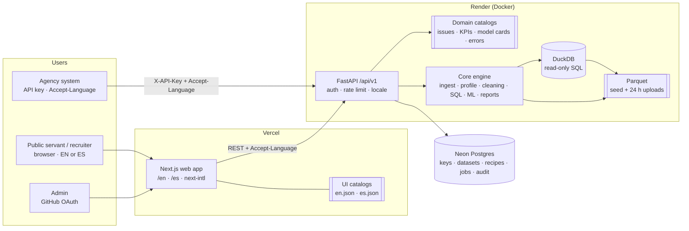
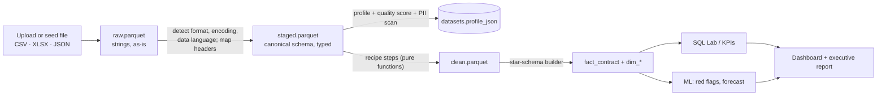
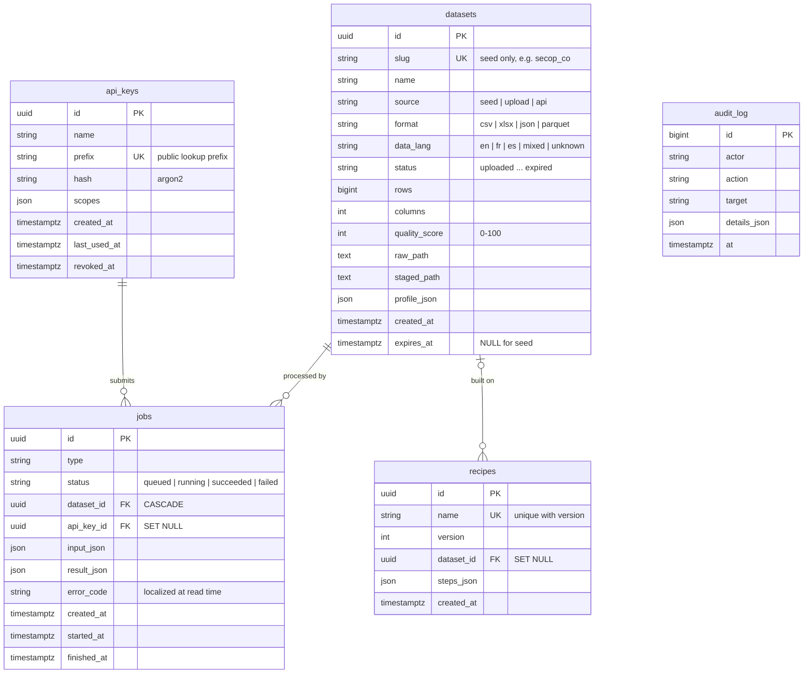
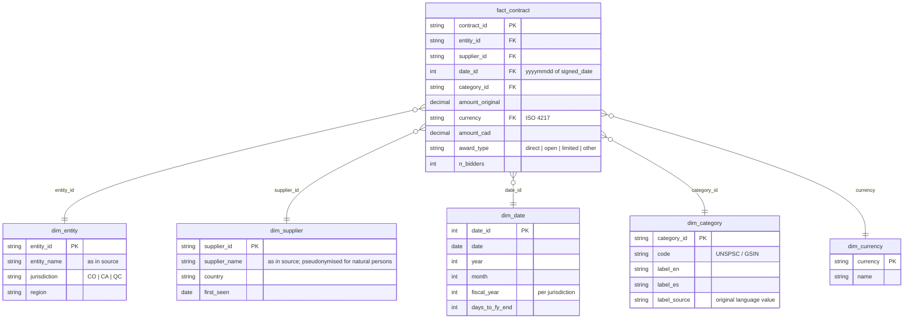
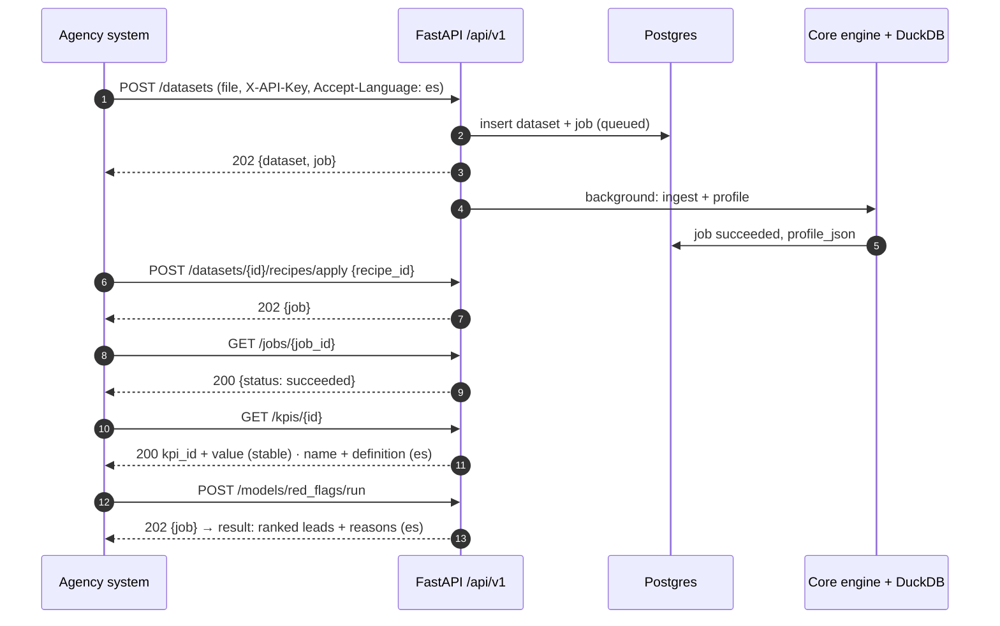

# CivicLens — Architecture

> Phase 4 deliverable. Decisions and trade-offs live in [`docs/adr/`](adr/README.md); the API contract is [`openapi.yaml`](../openapi.yaml); requirements in [`requirements.md`](requirements.md).

## 1. System context

| Component | Tech | Responsibility | ADR |
|---|---|---|---|
| Web | Next.js 14, next-intl, Tailwind, Radix | 6 screens + admin, UI strings, number/date formatting | 0001, 0007 |
| API | FastAPI, Pydantic v2 | `/api/v1` contract, auth, rate limit, language negotiation, jobs | 0004, 0007 |
| Core engine | pandas/Polars, DuckDB, scikit-learn, statsmodels | Pure functions: parse, profile, clean, model, report | 0002, 0006 |
| Analytics store | Parquet + DuckDB | Raw/staged/clean data and star schema | 0002 |
| App DB | Postgres (Neon), SQLAlchemy 2, Alembic | Keys, dataset metadata, recipes, jobs, audit | 0003 |
| Hosting | Vercel · Render · Neon | $0 | 0005 |

## 2. Data flow and lineage

Every arrow is recorded: recipes in `recipes`, runs in `jobs`, user decisions in `audit_log`. Same input + same recipe → same `clean.parquet` hash.

## 3. App database (migration 001)

Commands (from `apps/api`): `alembic upgrade head` · `alembic downgrade base` · `alembic -x url=<url> upgrade head`. `tests/test_migrations.py` runs upgrade → model/migration diff → downgrade on SQLite, and on Postgres 16 in CI.

## 4. Analytics star schema (DuckDB, built in slice 5c)

## 5. Canonical schema and seed mapping

Field names are English and never translated (ADR-0006, ADR-0007). Labels are translated in the catalogs.

| Canonical field | Colombia · SECOP II | Canada · federal | Québec · SEAO |
|---|---|---|---|
| `contract_id` | `id_contrato` | `reference_number` | `ocid` + `contrat_id` |
| `entity_name` | `nombre_entidad` | `owner_org_title` | `acheteur_nom` |
| `supplier_name` | `proveedor_adjudicado` | `vendor_name` | `fournisseur_nom` |
| `signed_date` | `fecha_de_firma` | `contract_date` | `date_signature` |
| `start_date` / `end_date` | `fecha_de_inicio_del_contrato` / `fecha_de_fin_del_contrato` | `contract_period_start` / `delivery_date` | — |
| `amount_original` | `valor_del_contrato` | `contract_value` | `contrat_montant` |
| `currency` | — (COP implied) | — (CAD implied) | `devise` |
| `award_type` | `modalidad_de_contratacion` | `solicitation_procedure` | `mode_sollicitation` |
| `n_bidders` | — | `number_of_bids` | `nombre_soumissionnaires` |
| `category_code` | `codigo_de_categoria_principal` | `commodity_code` | `unspsc_code` |
| `description` | `objeto_del_contrato` | `description_en` / `description_fr` | `avis_titre` |

## 6. Agency flow (US-25)

## 7. Cross-cutting concerns

| Concern | Approach |
|---|---|
| i18n | ADR-0007: UI catalogs in web, domain catalogs in API, `Accept-Language` → `Content-Language`, stable machine fields |
| Security | API keys (argon2 + prefix, scopes, revocation), admin via GitHub OAuth, read-only DuckDB + statement guard, upload type sniffing + 50 MB cap, CORS allowlist, PII masking |
| Errors | RFC 7807 with stable `code`; DB stores codes only |
| Jobs | Postgres rows + FastAPI background tasks; idempotent, re-runnable |
| Retention | Uploads `expires_at = now() + 24 h`, purge job; seed data permanent |
| Observability | `/health`; JSON logs with request id + locale; Sentry (Phase 10) |
| Accessibility | WCAG 2.1 AA; axe in CI on both locales |

## 8. Endpoint ↔ story map

| Endpoint | Stories |
|---|---|
| `GET /health` | US-26 |
| `GET /api/v1/datasets` | US-06, US-27 |
| `POST /api/v1/datasets` | US-07, US-25 |
| `GET /api/v1/datasets/{id}` | US-07 |
| `GET /api/v1/datasets/{id}/profile` | US-03, US-08, US-09, US-10 |
| `GET /api/v1/datasets/{id}/issues` | US-04, US-11, US-14 |
| `POST /api/v1/datasets/{id}/recipes/apply` | US-12, US-14, US-25 |
| `POST /api/v1/recipes` · `GET /api/v1/recipes/{id}` | US-12 |
| `GET /api/v1/recipes/{id}/export` | US-13 |
| `POST /api/v1/query` | US-15, US-16 |
| `GET /api/v1/guided-queries` | US-15 |
| `GET /api/v1/kpis/{id}` | US-17, US-22, US-23, US-25 |
| `POST /api/v1/models/{type}/run` | US-18, US-19, US-20, US-21, US-25 |
| `GET /api/v1/jobs/{id}` | US-25 |
| `GET /api/v1/reports/{id}` | US-05 |
| `GET/POST /api/v1/keys` · `DELETE /api/v1/keys/{id}` | US-24 |

Enforced by Spectral (`operation-user-stories` rule) and `apps/api/tests/test_openapi_contract.py`.
